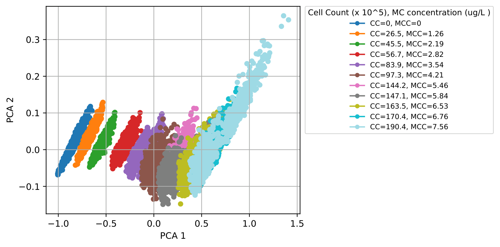
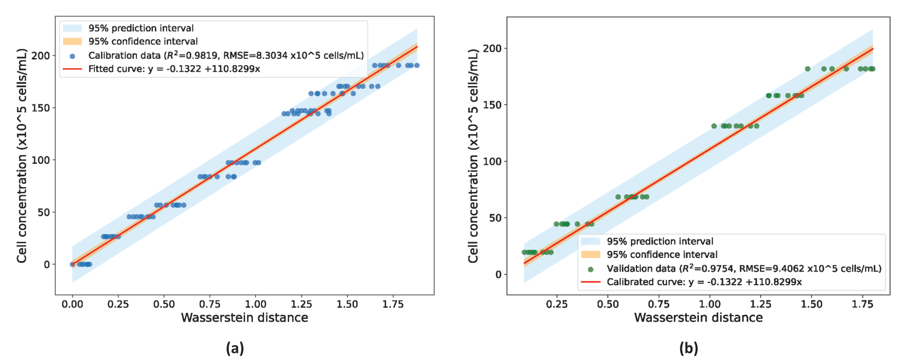
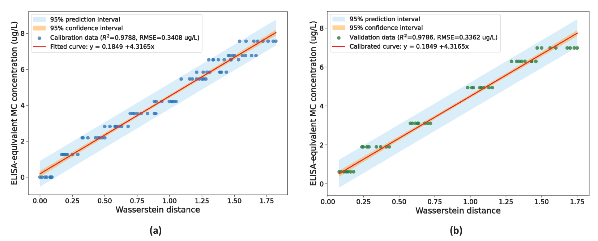

# Transmission-Mode Multispectral Imaging for Estimation of *Microcystis* spp. Cell Concentration and ELISA-Equivalent Microcystin Concentration in Water
[](#citation)
[](https://www.python.org/downloads/)
[](https://scikit-learn.org/)
[](https://opensource.org/licenses/MIT)

> **Status:** Manuscript submitted for journal review.

## Overview
Harmful algal blooms dominated by *Microcystis* spp. threaten freshwater systems through proliferation and microcystin (MC) production. Conventional measurement of cyanobacterial abundance and MC concentration usually needs laboratory processing, specialized instruments, or assay reagents. MC concentration also cannot always be inferred from cell abundance.

We propose a **transmission-mode multispectral imaging (MSI)** framework that estimates two separate monitoring targets from a single optical acquisition:

* *Microcystis* spp. **cell concentration**
* **ELISA-equivalent MC concentration**

A custom-built MSI system acquires twelve spectral bands from near-ultraviolet to near-infrared. After PCA-based dimensionality reduction, spectral variation is summarized by an **aggregated Wasserstein-distance descriptor**, which is then mapped to each target by a separate linear calibration model.

> MC estimates reflect an indirect empirical association within a controlled, culture-derived dilution series, not direct spectroscopic toxin detection.

## Methodology
The MSI system uses narrowband LEDs at `365, 405, 473, 530, 621, 660, 735, 770, 830, 850, 890, 940 nm` and a monochrome FLIR BFS-U3-13Y3M camera inside a dark chamber. One dark frame (all LEDs off) is captured per sample.

1. **Image preprocessing:** dark-current subtraction, a fixed 200 × 200 px ROI, and bilateral filtering (d = 9, σ<sub>s</sub> = σ<sub>r</sub> = 75).
2. **Data matrix construction:** the ROI is split into 100 non-overlapping 20 × 20 blocks; block means per band give a 100 × 12 matrix per imaging replicate.
3. **Feature transformation:** per-band min-max normalization, then a square-root transform and a Yeo-Johnson power transform. All parameters are fitted on calibration data only.
4. **PCA:** the first 4 principal components are kept (≥ 99% of calibration variance).
5. **Wasserstein descriptor:** 1-D Wasserstein distances along each PC to a fixed M8-medium (0%) reference sample, summed into one scalar descriptor $\mathcal{W}_i$ per replicate.
6. **Regression and evaluation:** separate linear models for each target, with 95% confidence and prediction intervals. The models are tested unchanged on held-out intermediate dilution levels.

### Dataset
| Split | Dilution levels (% v/v) | Imaging replicates | MSI descriptors |
| :--- | :--- | :---: | :---: |
| Calibration | 0, 10, 20, …, 100 (11 levels) | 8 per level | 88 |
| Held-out validation | 5, 15, 35, 55, 75, 95 (6 levels) | 8 per level | 48 |

Reference cell concentrations come from hemocytometer counts. Reference MC concentrations come from a competitive ELISA (Beacon MC Plate Kit, calibrated to MC-LR).

### PCA Feature Space

*Figure 1: Calibration block-level observations projected onto the first two principal components, grouped by concentration level.*

## Key Results
Both calibration relationships keep comparable performance on held-out intermediate dilution levels that were excluded from model fitting.

| Target | Split | R² | RMSE | MAE | Bias | 95% PI coverage |
| :--- | :--- | :---: | :---: | :---: | :---: | :---: |
| Cell concentration (×10⁵ cells mL⁻¹) | Calibration | **0.9819** | 8.3034 | 6.8740 | 0.0000 | 0.9773 |
| Cell concentration (×10⁵ cells mL⁻¹) | Held-out | **0.9754** | 9.4062 | 7.6229 | −3.5180 | 0.9167 |
| ELISA-equivalent MC (µg L⁻¹) | Calibration | **0.9788** | 0.3408 | 0.2856 | 0.0000 | 0.9773 |
| ELISA-equivalent MC (µg L⁻¹) | Held-out | **0.9786** | 0.3362 | 0.2719 | −0.0739 | 0.9792 |

**Fitted calibration models**

$$\hat{C}_{\text{cell}} = -0.1322 + 110.8299\,\mathcal{W} \qquad \hat{C}_{\text{MC}} = 0.1849 + 4.3165\,\mathcal{W}$$

### 1. Cell Concentration Estimation

*Figure 2: Cell concentration vs. aggregated Wasserstein distance. (a) Calibration data (88 replicates, 11 levels). (b) Held-out validation data (48 replicates, 6 levels) evaluated with the unchanged calibration model and uncertainty bands.*

### 2. ELISA-Equivalent MC Concentration Estimation

*Figure 3: ELISA-equivalent MC concentration vs. aggregated Wasserstein distance. (a) Calibration data. (b) Held-out validation data.*

## Repository Structure
```
microcystis-microcystin-msi/
├── create_datafiles.py                    # Preprocessing + block features -> Datafiles/*.csv
├── spectral_signature.py                  # Normalized spectral signatures (Fig. 1 of paper)
├── pca_plot.py                            # PCA feature-space plot
├── transformations_histrograms_plot.py    # Min-max / sqrt / Yeo-Johnson histograms (Fig. S2)
├── Regression_Wasserstein_Cellcount.py    # Wasserstein descriptor + cell-concentration regression
├── Regression_Wasserstein_Toxity.py       # Wasserstein descriptor + MC-concentration regression
├── toxity&cellcount_uncertainty_check.py  # CI/PI bands, bias, residual SD, PI coverage
├── files/                                 # Figures used in this README
└── LICENSE
```

## Getting Started

### 1. Environment Setup
```bash
# Clone the repository
git clone https://github.com/SenithJayakody/microcystis-microcystin-msi.git
cd microcystis-microcystin-msi

# Create a virtual environment (optional but recommended)
python -m venv msi_vEnv
source msi_vEnv/bin/activate  # On Windows use: msi_vEnv\Scripts\activate

# Install dependencies
pip install numpy pandas scipy scikit-learn matplotlib opencv-python statsmodels
```

### 2. Data Layout
The raw images are not included in this repository (see [Data Availability](#data-availability)). `create_datafiles.py` expects:
```
Data/
├── Train/        # calibration samples
│   └── T_<level>_..._<replicate>/
│       ├── 000nm.png   # dark frame (all LEDs off)
│       ├── 365nm.png
│       ├── ...
│       └── 940nm.png
└── Validation/   # held-out samples, same structure
```

### 3. Usage
Run the scripts from the repository root, in this order:
```bash
# 1. Build block-level feature CSVs (Datafiles/dataAll_Water_Train.csv, dataAll_Water_Validation.csv)
python create_datafiles.py

# 2. Visualizations
python spectral_signature.py
python pca_plot.py
python transformations_histrograms_plot.py

# 3. Wasserstein-distance regression for each target
python Regression_Wasserstein_Cellcount.py
python Regression_Wasserstein_Toxity.py

# 4. Uncertainty and error analysis
python "toxity&cellcount_uncertainty_check.py"
```
All figures and result CSVs are written to `Plots/`.

## Data Availability
The datasets generated and analysed in this study are available from the corresponding author on reasonable request.

## Citation
If you find our work useful in your research, please cite:
```
@article{jayakody2026msi,
      title={Transmission-Mode Multispectral Imaging for Estimation of Microcystis spp. Cell Concentration and ELISA-Equivalent Microcystin Concentration in Water},
      author={J.A.S.T. Jayakody and G. Thilakarathne and G.A.S.L. Ranasinghe and M.C.L. De Silva and K.A.D.S.A. Perera and G.M.R.I. Godaliyadda and H.M.V.R. Herath and M.P.B. Ekanayake and A.D.S.N.P. Athukorala and H.A.D.R.P. Sirimanna},
      note={Manuscript under review},
      year={2026}
}
```

## License
This project is released under the MIT License. See the [LICENSE](LICENSE) file for details.

## Contact
If you have any questions, please feel free to email the authors.
> e19312@eng.pdn.ac.lk · senith@eng.pdn.ac.lk · gayathrit@eie.ruh.ac.lk
